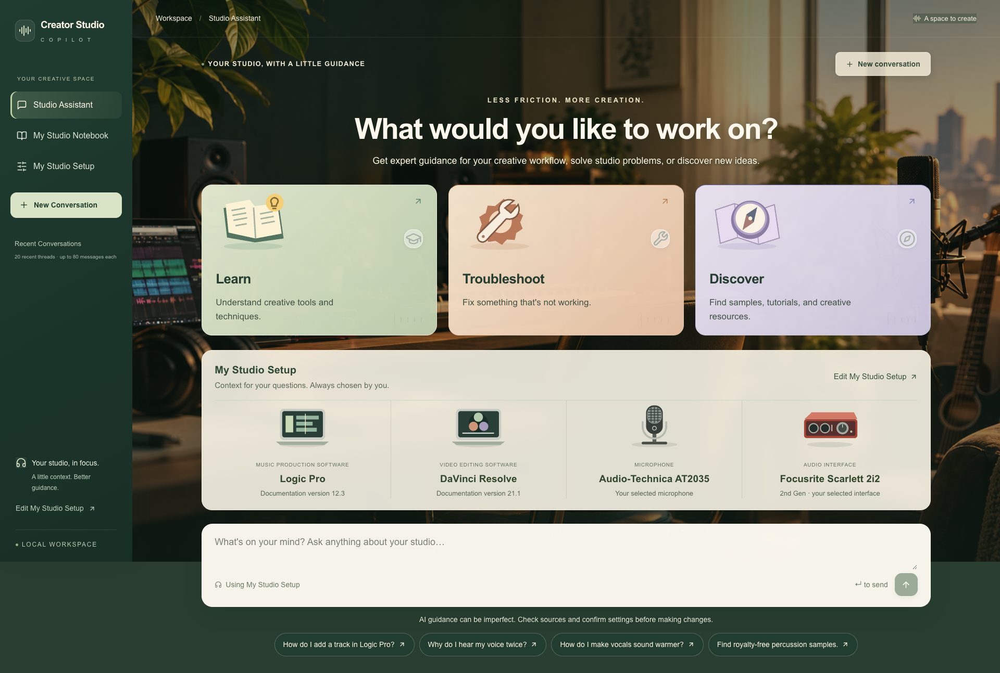
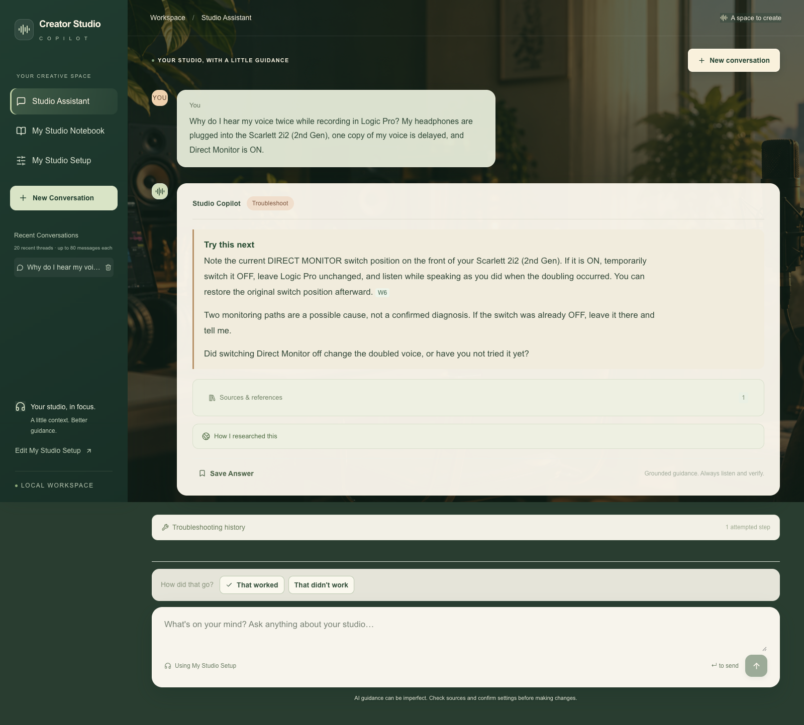
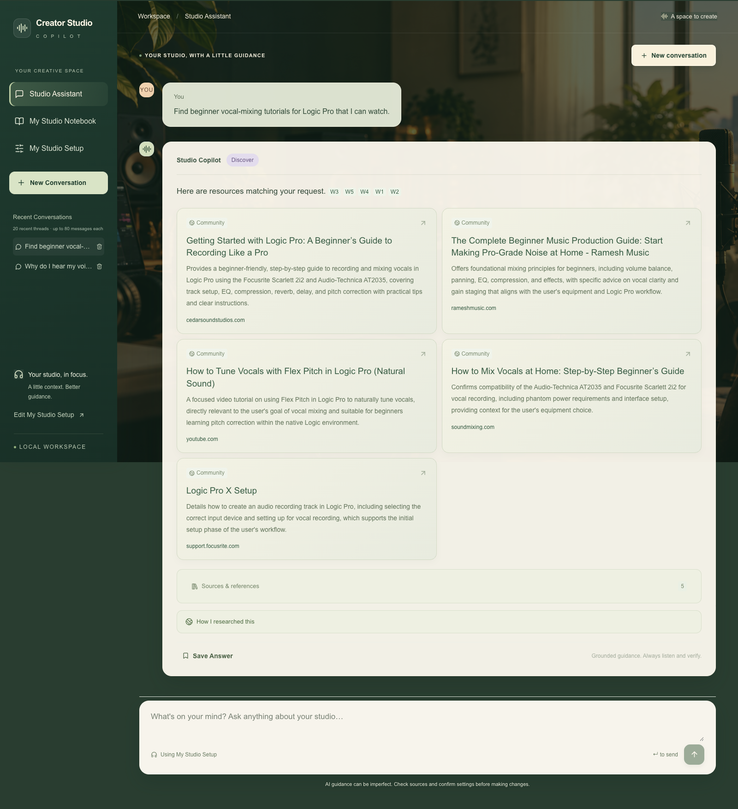
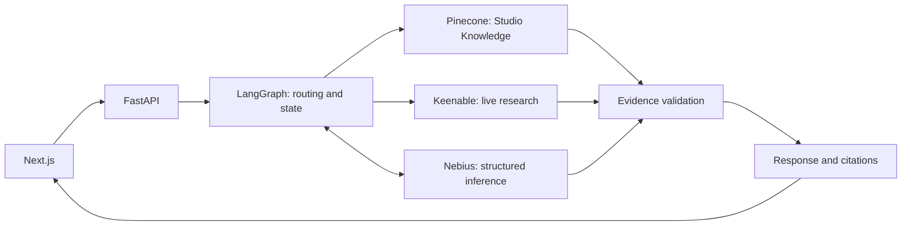

# Creator Studio Copilot

**Your AI-powered creative studio companion.**

Learn music and video production, troubleshoot recording problems, and discover useful resources—with guidance informed by your studio setup and grounded in sources.

**Next.js · FastAPI · LangGraph · Pinecone · Nebius · Keenable**



[Architecture](docs/architecture/system_architecture.md) · [Agent workflows](docs/architecture/agent_workflows.md) · [Evaluation](evaluations/README.md) · [Quick start](#quick-start)

## What it does

Creators often move between disconnected manuals, tutorials, forums and support pages to solve one problem. Creator Studio Copilot brings that research into a conversation that knows the selected tools and retains diagnostic context.

| Workflow | What you can do | Try asking |
|---|---|---|
| **Learn** | Understand audio/video concepts, get grounded explanations, and follow product instructions when supported by evidence. | “How do I add a compressor to an audio track in Logic Pro?” |
| **Troubleshoot** | Diagnose problems across turns, try a supported action, and report what changed. | “Why do I hear my voice twice while recording?” |
| **Discover** | Find tutorials, creative resources and samples through live research, with sources and relevant usage-rights uncertainty. | “Find beginner vocal-mixing tutorials for Logic Pro.” |

<details>
<summary>See a real monitoring check</summary>



Actual output with setup facts supplied in the question. The action tests a possible cause; it does not claim a confirmed diagnosis.

</details>

<details>
<summary>See real resource discovery</summary>



Actual returned results include broader production and setup resources. Responses and source links were not fabricated.

</details>

## Your studio, personalized

- **My Studio Setup:** Logic Pro and DaVinci Resolve context, plus your selected microphone and interface. Defaults are AT2035 and Scarlett 2i2 2nd Gen; documentation versions are not assumed installed versions.
- **My Studio Notebook:** save useful answers and revisit them whenever you need them. Individual answers, citations and editable topic titles are stored locally in your browser; it does not automatically summarize entire troubleshooting conversations.
- **Recent Conversations:** return home or start a new thread while keeping previous browser-local conversations accessible.
- **Live Research Activity:** follow the assistant’s progress as it searches Studio Knowledge, checks documentation and researches the web. Indicators reflect actual backend operations, not simulated progress; each request uses only the tools its workflow calls for.
- **Source citations:** distinguish original Studio Knowledge, official documentation and community resources.

Product scope: Logic Pro, DaVinci Resolve, Scarlett Solo, Scarlett 2i2, AT2020 and AT2035. Support depends on available evidence and applicable versions.

## How it works



Conceptual questions generally use Studio Knowledge. Product-specific how-tos prioritize official documentation; Discover searches for resources. Creative advice can combine conceptual retrieval with research. **Every query does not use every tool.** LangGraph preserves context; Nebius handles structured decisions and generation; source and answer checks reject unsupported details.

## Engineering highlights

- **Original knowledge:** 12 AI-assisted educational guides with reference metadata, stable IDs and source hashes; manufacturer manuals are not uploaded by the active pipeline.
- **Retrieval:** three deterministic chunking strategies and Pinecone integrated embeddings using `llama-text-embed-v2`. The agent uses strategy B, top five passages.
- **Stateful diagnosis:** tracked questions, pending actions, reported outcomes and repeated-fix guards through a LangGraph memory checkpointer.
- **Grounding:** product/version provenance, exact source spans for procedures, and intent-specific contracts for explanations, creative advice, diagnosis and resources.
- **Streaming:** actual tool activity over SSE, with same-request fallback to JSON chat. Hidden reasoning is never displayed.

## Evaluation

The retrieval benchmark contains **20 golden questions: 16 supported and 4 unsupported by Studio Knowledge**. Corpus-negative labels do not prescribe full-agent refusals.

| Strategy | Approximate target / overlap | Records | Saved source Recall@5 |
|---|---|---:|---:|
| A · small | 300 / 45 tokens | 36 | 1.000 |
| B · medium | 500 / 75 tokens | 24 | 1.000 |
| C · structure-aware | ~800 cap; no sliding overlap | 12 | 1.000 |

Recall measures expected **guide IDs** found in the top five **chunks**, averaged over the 16 positive questions. **Retrieval recall is not answer accuracy.** This small author-designed set does not measure passage precision or refusal correctness; token counts are local estimates.

A separate **12-scenario agent set** covers tool choice, grounded procedures, creative advice, multi-turn diagnosis, discovery, licensing and insufficient evidence. Linked scripted-provider checks test policy behavior, not complete live replays or universal answer quality. See the [evaluation guide](evaluations/README.md) for commands and limitations.

## Quick start

Requirements: **Python 3.11**, **uv**, **Node.js 24**, and configured Nebius, Pinecone and Keenable accounts.

From the project root:

```sh
cd backend
uv sync --frozen
cp .env.example .env
cd ../frontend
npm ci
```

Set `PINECONE_API_KEY`, `PINECONE_INDEX_NAME`, `NEBIUS_API_KEY` and `KEENABLE_API_KEY` in `backend/.env`. Never expose provider keys in frontend configuration. For a different API URL, copy `frontend/.env.example` to `frontend/.env.local` and set `NEXT_PUBLIC_API_BASE_URL`.

Chat requires a compatible, populated Pinecone index. Original-guide preparation is offline; index bootstrap and uploading are explicit cloud operations. Follow the [backend setup guide](backend/README.md#knowledge-setup) before the first chat.

Run in separate terminals:

```sh
# From backend/
uv run uvicorn app.main:app --reload --port 8000
```

```sh
# From frontend/
npm run dev
```

Open **http://localhost:3000**. Health: **http://localhost:8000/health**. API docs: **http://localhost:8000/docs**.

## Documentation

- [System architecture](docs/architecture/system_architecture.md) — components and storage boundaries.
- [Agent workflows](docs/architecture/agent_workflows.md) — actual graph, routing, diagnostic state and fallback behavior.
- [RAG architecture](docs/architecture/rag_architecture.md) — preparation, chunking, indexing and evaluation.
- [Component reference](docs/architecture/component_reference.md) — modules and integration points.
- [Backend guide](backend/README.md) · [Frontend guide](frontend/README.md) · [Evaluation guide](evaluations/README.md).

## Limitations

- Local-first, single-worker execution; no authentication for public hosting.
- Notebook, setup and recent conversations stay in the current browser/origin, without account sync.
- Backend restarts lose diagnostic sessions; stored messages remain visible but old session continuation can fail.
- Answers depend on external source availability, applicability and model judgment. Original guides are not independently human-verified.
- Some reusable resources have unverified usage rights. Free downloads do not establish permission or clear underlying composition rights.

The studio background was generated using ChatGPT's image-generation capability specifically for this project. This is a public portfolio repository with no open-source license granted; third-party resources retain their own usage conditions.
