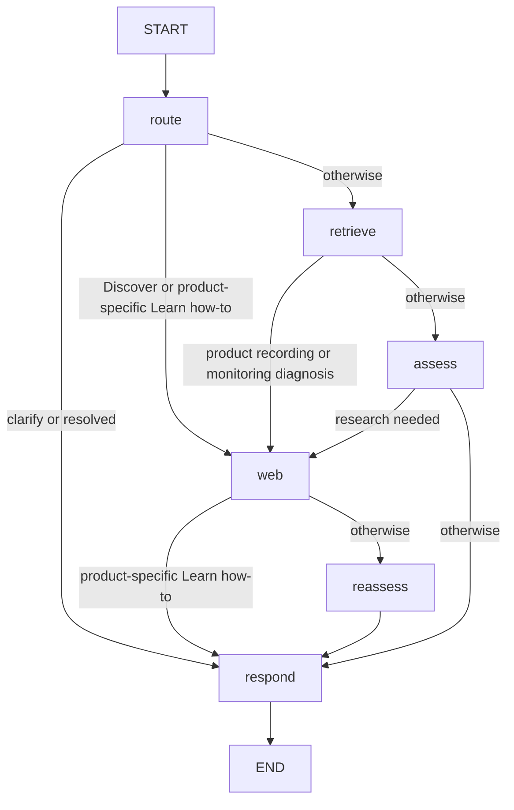

# Agent workflows

`backend/app/graph/workflow.py` builds a bounded graph around the existing retrieval service. Helpers for source spans, monitoring and resource permissions are ordinary Python functions, not separate agents or graph nodes.

## Actual graph

The six nodes are `route`, `retrieve`, `assess`, `web`, `reassess`, `respond`. Assessment and reassessment share `_assess`. There is no edge from reassessment back to research. Interactive diagnosis continues on the next user turn; the graph does not loop indefinitely within one request. Recursion limit is 12.

## Routing and context

The Nebius router returns a validated `Route`: intent, goal, equipment, user-stated version, software specificity, new-goal flag and action outcome. Input includes the last 16 messages, current goal/intent, studio context and latest step. Structured output has at most two schema attempts.

Routing is hybrid. Python guards preserve short diagnostic replies, reconcile explicit equipment overrides, avoid confusing documentation editions with installed versions, and distinguish creative goals from exact UI requests. A short switch answer is interpreted against the most recent pending switch question, never the isolated word “ON.” Router/evaluator inputs are windowed; full messages remain checkpointed, with no summary model.

`AgentState` contains session/messages, goal/intent, equipment/version/primary software, questions, steps/outcomes, evidence/citations, research history, assessment, response/status, activities and answer checks. Evidence is reset per turn; diagnostic context is retained unless a genuinely new topic starts.

## Learn

- **Conceptual:** retrieve raw approved Studio passages with strategy B/top five, then assess. `_next` requests research for insufficient evidence, explicit web need, failed earlier actions or product-specific diagnosis; otherwise it responds.
- **Product-specific how-to:** route directly to official research, bypassing generic retrieval/assessment. Bounded page fetches prioritize applicable editions and task-related sources; an explicitly returned task link may be followed. Response uses exact source-span extraction and a completeness review.
- **Creative advice:** qualitative sound goals select a separate contract. Start with concepts and use research when assessment requires it. Keep individually supported suggestions; reject invented values/UI paths. No complete software procedure is required for a creative goal.

A supported how-to requires a nonempty essential procedure. Literal span/product/version checks precede a bounded completeness review; optional unsupported steps/checks are omitted without rejecting a supported core. If essential evidence is absent, return explicit insufficiency. Unknown installed version does not automatically block a scoped documented procedure; incompatible editions must not be merged.

Conceptual responses use `LearnAnswer` plus review, factual/context heuristics and citation checks. General Studio references cannot establish official UI controls. A model review is not independent proof of factual correctness.

## Troubleshoot

The original symptom stays the goal across diagnostic answers. Conceptual retrieval supports reasoning; product recording/monitoring issues go from retrieval directly to research, then reassessment. The response chooses one useful observable question or a supported reversible action. It does not control equipment or software.

| Decision | Existing state representation |
|---|---|
| Need observation/clarification | `diagnosing` or `clarifying` with a question |
| Ready for action | Context/evidence predicate inside response selection |
| Await result | `awaiting_outcome`, step outcome `pending` |
| Success | `resolved` and recorded reported outcome |
| Unsupported | `unsupported` with a limitation |

Questions are stored and similarity-checked. Steps carry action keys, text, outcome and subsequent user reports. Duplicate text/action keys block repetition; a failed action permits a different supported step or further observation. Pending work is not automatically reset to a fresh questionnaire.

### Direct Monitor example

For Scarlett 2i2 **2nd Gen**, the web helper fetches the applicable official Focusrite section. Only verified generation-specific evidence permits the physical switch/location claim. The beginner check can ask ON/OFF, accept uncertainty and simplify observation.

When the pending switch question receives “It's ON,” “On,” “Yes, it's on,” or “The switch is enabled,” deterministic interpretation preserves intent/goal and enables the evidence-gated isolation test. The action temporarily turns Direct Monitor OFF, leaves Logic Pro unchanged and asks whether doubling disappeared. Confirmed ON suppresses already-OFF branches. An alternative readiness path uses confirmed Scarlett headphones plus a delayed duplicate. Steps remain pending until a reported result; “That fixed it” resolves and “Still doubled” marks failure without repeating that test. The cause remains a hypothesis.

These are scoped reliability rules, not a general hardware engine. Missing applicable evidence or contradictory instructions must not be replaced by guessed controls. Other exact software steps require official supporting spans in `step_evidence`.

## Discover

Discover researches directly through Keenable and then reassesses. Search returns up to five normalized results; official instructions are preferred where applicable, while community resources are labeled. `DiscoverAnswer` selects supplied IDs; the server supplies URLs and the frontend sanitizes links.

For reusable material, at most the first three result pages are checked for terms. `license_evidence` recognizes narrowly explicit, resource-scoped Creative Commons statements and rejects detected restrictions/exceptions. Free-download snippets are not proof. Viewing tutorials does not require a prominent reuse warning. Failed or ambiguous checks leave permissions unverified; underlying composition rights are separate.

Search and official fetches have bounded retries. Resource fetches make one attempt; HTTP, timeout, transport, parsing, extraction and source-validation failures remain visible. Empty relevant selection becomes a limitation. This is not a comprehensive licensing parser or clearance service.

## Clarify and evidence handling

An unclear goal routes directly to `respond` for clarification without tools. The next turn is routed using conversation context; there is no special return edge. An assessment can also request clarification within a retained intent when missing context materially determines the next safe action.

The structured evaluator considers sufficiency, product/version relevance, clarification, research need, contradiction and safe-next-action support using the last 12 messages. Deterministic corrections suppress redundant setup/version questions. Product procedures bypass general assessment in favor of their source-span contract; creative and generic responses have their own reviews. Evidence and conversation remain untrusted data. Golden answerability labels are never runtime routing/refusal rules.

Completion counts vary by path and bounded repair attempts. Progress reports actual operations without revealing prompts, source contents or hidden reasoning. For transport behavior, see [system architecture](system_architecture.md).
