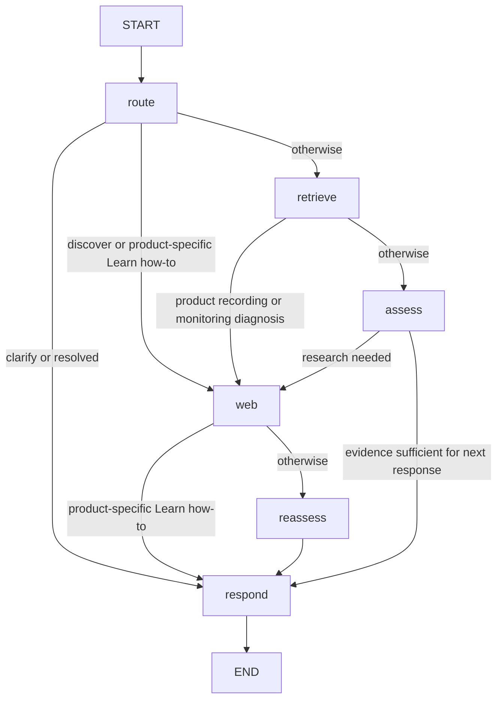

# LangGraph workflows

Reviewed 2026-10-25. Source: `backend/app/graph/workflow.py`, state/router/helpers and evidence evaluator.

## Actual graph

These are the six real nodes: `route`, `retrieve`, `assess`, `web`, `reassess`, `respond`. `assess` and `reassess` invoke the same `_assess` function. There is **no graph edge back from reassess to web**. Interactive diagnosis repeats on the next HTTP request, not through a looping graph within one turn. Session config uses recursion limit 12. Helper functions for procedure extraction, creative reviews, monitoring, provenance and resource terms are not graph nodes.

## State and intent

`AgentState` tracks session ID, messages, intent, equipment, goal, user-stated version, primary software, questions asked, steps/action keys/outcomes, evidence, citations, web history, evaluator result, response, status, activities and answer checks. It also carries `how_to`, `software_specific`, `creative_goal`, `new_topic`, errors and web-attempt flags.

`router.route` asks the configured Nebius model for a validated `Route`. Input includes the last 16 messages, current goal/intent, studio context, equipment/version and most recent attempted action. Temperature is 0. It classifies `learn`, `troubleshoot`, `discover`, or `clarify`, extracts setup and outcome, and indicates a genuine new topic. Pydantic and provider-side JSON Schema enforce output shape; no Jev is used.

Routing is **hybrid**: ordinary Python rules preserve short follow-ups, reconcile explicit equipment overrides, prevent documentation-version confusion, detect creative goals and identify UI/how-to requests. A short Direct Monitor answer is resolved against the immediately preceding stored diagnostic question, not the text “ON” in isolation. Scoped outcome rules associate “That fixed it” and “Still doubled” with the pending monitoring action. Other diagnosis continues to rely on model routing plus broader context guards.

Ambiguous requests go to `clarify` and get a question without retrieval. On the next user turn the router sees previous messages and decides the appropriate intent; there is no separate “return to previous node” edge. Evidence assessment may also request clarification while retaining the original intent. Router context is truncated by message count; evaluator context uses the last 12 messages. The checkpoint retains the full messages list; no separate summary model runs.

## Learn

- **Conceptual:** `retrieve` asks `StudioRAG.retrieve(goal, strategy='B', top_k=5)`. Raw approved passages are used; no generated RAG summary is inserted between retrieval and the agent. `assess` checks usefulness and scope. `_next` requests web research for insufficiency, failed prior actions or other explicit research needs.
- **Product-specific how-to:** route goes directly to `web`, prioritizing official evidence rather than generic concept chunks. Software specificity and how-to are separate state flags; a named product does not automatically make every explanation a menu procedure. Task-linked Apple pages may be fetched when a returned official page supplies their links. Current/matching editions and task-oriented results are prioritized and duplicate guide IDs reduced.
- **Creative goal:** phrases such as making vocals warmer select a creative contract rather than a mandatory UI procedure. Retrieval starts with concepts; evidence assessment can trigger web fallback. `generate_advice` returns up to four source-supported suggestions, with exact supporting spans and a review. Numeric recipes and exact UI claims are blocked in this contract. Unsupported suggestions are omitted individually; if none survive, a limitation is returned.

For how-to responses, `_respond_procedure` calls `generate_procedure`: a structured nonempty source-span procedure or explicit insufficient-evidence state; literal span/product/version validation; then a bounded completeness review. The renderer uses verified source wording rather than inventing UI paraphrases. Optional success checks require their own supporting span. Takeaway-only output is not a successful how-to. A known documentation edition can be explained with scope when the installed version is unknown; incompatible editions must not be merged.

Other conceptual Learn responses use `LearnAnswer`, draft reviews, citation checks and factual/context heuristics in `_respond`. Product menus cannot be established by a general Studio guide. Model-based review remains fallible; exact spans are support evidence, not proof the extracted procedure covers every real-world prerequisite.

## Troubleshoot

The original symptom remains `goal` across diagnostic answers. Setup is supplied from the frontend, reconciled with explicit user statements, and included in routing, evaluation and generation. A product recording/monitoring symptom routes `retrieve → web → reassess → respond`; generic troubleshooting may first pass through `assess`.

The response node chooses a question or one supported action using structured `DiagnosticReply`, evaluation and deterministic helpers. Questions are recorded and similarity-checked; actions carry `action_key`, `text`, `outcome` and, after a report, `user_report`. Duplicate action keys/text and failed fixes are blocked. Pending actions retain `awaiting_outcome`; the assistant must not treat each reply as a fresh questionnaire.

| Decision meaning | Existing representation |
|---|---|
| Needs clarification/observation | `clarifying` or `diagnosing`, plus diagnostic question |
| Ready for action | Evidence/context readiness checks inside response selection; not a separate graph node or persistent enum |
| Awaiting action result | `awaiting_outcome` and a step with `outcome: pending` |
| Resolved | `resolved`, with action outcome updated |
| Insufficient evidence | `unsupported` and a limitation |

### Direct Monitor journey

For the selected Scarlett 2i2 **2nd Gen**, `monitoring.py` requires an applicable official Focusrite article section before naming the physical switch/location. The web helper fetches the fixed official reference via Keenable and stamps the applicable generation/product evidence. It does not upload manuals.

1. User reports hearing their voice twice while recording. A verified beginner check can ask whether DIRECT MONITOR is ON or OFF.
2. “It's ON,” “On,” “Yes, it's on,” or “The switch is enabled” is interpreted only when the last pending question is that switch question. The original intent/goal remain intact even if model routing misclassifies the short reply.
3. `isolation_test` accepts this observation (or the separately supported headphone/delayed-copy path), checks official evidence and conflicts, and blocks previously attempted actions.
4. `_monitoring_action_reply` recommends temporarily turning Direct Monitor OFF, leaving Logic Pro unchanged and listening again. Confirmed ON suppresses already-OFF branches. Cause remains uncertain. A source citation and “Did the doubling disappear?” accompany a pending action.
5. “That fixed it” resolves the action/session. “Still doubled” marks failure, retains the symptom, and permits further diagnosis without repeating that action. “Not tried yet” keeps it pending.

These are scoped deterministic reliability rules, not a general hardware-control engine. The application does not move the switch or control Logic Pro. Missing applicable documentation must not be replaced with guessed controls. Exact software actions elsewhere require official spans in `step_evidence`.

## Discover

Discover routes to `web` directly. Keenable `POST /v1/search` is bounded to five results; result titles, descriptions, URLs and snippets are normalized. Official product domains are preferred for instructions; discovery can include labeled community resources. `GET /v1/fetch` reads bounded indexed HTML, not arbitrary PDF manuals or an autonomous crawler.

For reusable material, the first three result pages may be fetched for usage terms. Viewing tutorials does not trigger reuse warnings merely because licensing is unknown. `license_evidence` only accepts narrowly explicit resource-scoped Creative Commons statements and rejects detected exceptions/restrictions. It is not a comprehensive license parser or legal clearance service. Failed fetches remain unverified; “free download” and “royalty-free” snippets are not proof of permission. Composition/cover rights are separate from sample permissions.

`DiscoverAnswer` selects supplied resource IDs, not invented URLs. Citations supply card fields, the UI sanitizes links, and reuse cards show verified terms or “License not verified.” Empty relevant selection becomes an explicit limitation. Resource fetches have one attempt; HTTP/timeout/transport/extraction/parsing/source-validation failures are recorded. Search and official-document fetches have bounded retries. The graph does not keep searching until a desired permission is obtained.

## Evidence handling and bounds

`evaluate` is an LLM-based structured pre-answer assessment: sufficiency, product/version relevance, clarification, web need, contradiction and safe-next-action support. Deterministic corrections suppress redundant setup/version questions and enforce missing/conflicting evidence gates. The procedural path bypasses this general assessment in favor of source-span/completeness validation; creative and generic replies have their own reviews.

Source types distinguish original concepts, official applicable documentation, community/tutorials and unknown sources. URL/domain checks and source hashes provide provenance boundaries, not immunity to prompt injection or semantic error. Untrusted evidence is explicitly kept as data in prompts. Citation IDs must refer to supplied sources. No benchmark answerability label participates in routing or refusal.

No constant completion count applies: the route, assessment/reassessment, extraction/generation, review and possible repair calls vary by path. Direct product how-to normally avoids the generic retrieve/assess stage; monitoring helpers can avoid a model-generated response after research. Bounded retries can still amplify latency. Public progress events reveal operation names/status only, not private reasoning.
