# RAG architecture and evaluation

Reviewed 2026-10-25. The production retrieval corpus and the historical PDF experiment are distinct.

## Current knowledge base

`data/studio_knowledge/` contains 12 original, AI-assisted educational guides: microphones; gain staging; monitoring; EQ; dynamics; space effects; MIDI; recording/editing; video basics; synchronization; color; export. Each has substantial prose, headings, examples, practical checks and limitations. `manifest.json` records stable guide IDs, paths, SHA-256 hashes, reference IDs, authorship, scope and review status. Referenced external sources are attribution/technical support; the guides are not official manufacturer documentation and are explicitly **not independently human-verified**.

The design avoids uploading manufacturer manuals: original educational material supports concepts in Pinecone, while exact product instructions are researched live through official web sources. This separates corpus ownership/provenance from version-specific documentation. It does not establish a blanket legal determination about external sources.

## Active build and query flow

```mermaid
flowchart LR
    Guides[Original Markdown guides and manifest] --> Validate[validate_guides: hashes, structure, references]
    Validate --> Build[prepare_studio: load and construct guide sections]
    Build --> Split[chunk_sections A / B / C]
    Split --> Outputs[Ignored data/studio_processed JSONL]
    Outputs --> Records[Validate flat metadata and deterministic IDs]
    Records -->|explicit studio_cli index| PC[(Pinecone Studio namespaces)]
    Query[User query] -->|query text, default B top five| PC
    PC --> Hits[Text and metadata hits]
    Hits --> Guard[StudioRAG guide ID / corpus / source hash checks]
    Guard --> Agent[Raw passages and citations to LangGraph]
    Guard --> Ask[Standalone ask: Nebius grounded generation]
```

Phase 5B removed the historical manual-shingle prerequisite. `prepare_studio()` now uses only original guides and their manifest/references. A clean-tree offline test verifies stable full source coverage and identical generated A/B/C records without `data/corpus` or `data/processed`. No new plagiarism guarantee is claimed.

### Loading and cleaning

`ingest.load_documents` supports local PDF, Markdown and UTF-8 text with manifest paths and an explicit product allowlist. Default corpus resolution is anchored to the project; user-supplied relative paths remain relative to the command's working directory. Cleaning normalizes whitespace, drops empty content, and conservatively removes identifiable repeated PDF edges/page numbers. It does not provide OCR.

For original guides, `prepare_studio` validates the guide manifest, writes guide source entries, uses the loader with the explicit `Studio fundamentals` allowance, and constructs one section per guide with headings, content hash, attribution and logical-page metadata. This is distinct from selecting excerpts from manuals.

### Chunking and identities

| Strategy | Target / overlap | Studio namespace | Current local chunks |
|---|---|---|---:|
| A | Approx. 300 / 45 tokens | `studio-small-300` | 36 |
| B | Approx. 500 / 75 tokens | `studio-medium-500` | 24 |
| C | Structure-aware approx. 800 cap / zero sliding overlap | `studio-structure-aware` | 12 |

The deterministic token estimate counts up-to-four-character word pieces and punctuation; it is **not** the embedding/model tokenizer. Heading prefixes consume the target budget. Fixed strategies use whole-word windows with overlap. Structure-aware ranges preserve headings/paragraphs/procedures when possible; oversized units split with repeated heading/introduction context. Source-body coverage is checked by offsets, not just section ID equality. Small indivisible units/tokenizer differences mean target lengths should not be advertised as exact provider-token guarantees.

Chunk metadata preserves document/source/section/chunk IDs, strategy/configuration, original text offsets, page spans, title, topic, guide path, source hash, authorship, references and supported-product applicability. Markdown pages are logical provenance fields, not PDF page claims. Stable IDs are hashes of source/configuration/text identity; Pinecone record IDs hash source ID, configuration and chunk ID.

### Embedding and indexing

`studio_cli.index_studio` explicitly prepares original-guide records, validates all three strategies, rejects non-original records, and connects to an existing compatible index (`create=False`). Batches use `upsert_records`, with default 32 records and a maximum 96, plus byte-size limits. Pinecone integrates passage embedding; no local embedding model or separate embedding API call is used.

`check_compatible` enforces dense/cosine/1,024 dimensions, `llama-text-embed-v2`, serverless configuration, `text: chunk_text`, correct query/passage types, and truncation disabled. The general store can create an index for explicit administrative commands; runtime does not create it. The original-guide indexing command verifies stored text/metadata visibility after uploading. It does not delete stale IDs from earlier guide revisions; reindexing is not a replacement/synchronization policy.

### Runtime retrieval and generation

`StudioRAG.retrieve` searches the Studio namespace, defaults to B and top five, validates citation metadata and approved guide revision, and returns raw text/citation maps. `retrieve.search` supports product filters using `applies_to` for Studio namespaces; the current agent `_retrieve` does not pass a product filter. There is no active BM25 hybrid retrieval, reranker, relevance score threshold or query-expansion agent despite some installed dependencies.

`POST /ask` invokes standalone grounded `StudioRAG.answer`, with its own JSON/citation checks and an `answerable` result based on returned evidence. `/chat` instead reuses **retrieve**, then uses intent-specific generation. Product how-to may bypass Pinecone entirely. Studio hashes prevent an unapproved revision being used, but do not authenticate that remote text is identical to local text on every retrieval; indexing visibility checks cover uploaded records separately.

## Historical manual pipeline

The privately archived `data/sources.json` listed six PDFs. Archived selection metadata and the former `rag/prepare.py` command implemented curated ranges, cleanup and quarantine reporting. Manual-derived outputs had A/B/C counts **375 / 232 / 168**. The public `prepare.py` retains only shared JSONL/source-coverage helpers; synthetic-tested preprocessing/chunking utilities remain because the Studio build uses them. They are not the current Studio counts and are not queried by the active agent.

Manual namespaces `small-300`, `medium-500`, `structure-aware` and the isolated `integration-test` are supported by lower-level tools. Phase 5B removed `pinecone_cli upsert` and the manual dataset command paths from the public project; its sole retained command is the synthetic integration test. Synthetic tests use five explicitly labeled fixture records; their semantic success is not a production retrieval score.

Historical original-PDF page counts/coverage audits explain why the corpus strategy changed. Retain permitted selection metadata and code for reproducibility, but keep PDFs, extracted text, quarantine excerpts and raw third-party traces private pending redistribution review.

## Evaluation

`data/golden_questions.json` is the **20-question RAG-only** set: 16 supported and four unsupported by the original guides. Each carries `evaluation_scope: rag_only`, `rag_answerable`, `relevant_source_ids` and `expected_facts`. IDs remain stable. Unsupported means unsupported by Studio Knowledge, not impossible for the full agent. The revised automation question no longer assumes each mode has a menu command and shortcut.

`studio_cli evaluate` searches all three Studio namespaces without indexing, generating answers or doing web research. For positive question q:

`source recall@5(q) = |expected guide IDs intersect guide IDs in top 5 chunks| / |expected guide IDs|`.

The reported score is the macro average over 16 positive questions. All three saved Phase 5A results are **1.000**. Negative queries are excluded from the denominator and have null recall. Same positive queries/source judgments make this recall comparable with the saved baseline; revised negative wording and network variation make aggregate latency comparisons non-controlled.

Recall measures **guide retrieval coverage**, not answer accuracy, passage precision, useful ranking, refusal correctness or licensing correctness. Returning a nearby chunk for a negative does not mean the requested fact exists. The small author-designed set has a ceiling effect and is not an unbiased benchmark.

`data/agent_golden_questions.json` separately defines 12 full-agent scenarios: concepts, official how-to, creative goals, multi-turn diagnosis, resources, licensing and insufficient evidence. It distinguishes verified support, research candidates and conditional post-research insufficiency. `scripts/evaluate_agent.py` runs ten scripted real-graph scenarios. `evaluate_agent_golden.py` runs linked policy checks for 12 scenarios, **not complete live replays**. Their pass rates are not full-agent quality metrics. Golden labels are evaluation-only and not read by runtime decision logic.
