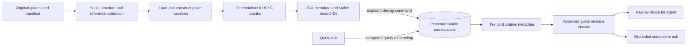

# RAG architecture

The active corpus is `data/studio_knowledge/`: **12 original AI-assisted educational guides** covering microphones, gain staging, monitoring, EQ, dynamics, space effects, MIDI, recording/editing, video basics, synchronization, color and export. They contain headings, explanations, examples, practical checks and scope limits.

`manifest.json` records stable guide IDs, paths, content hashes, authorship and reference metadata. The guides are not official manufacturer documentation or independently human-verified technical advice. External references provide attribution/support; exact product instructions are researched separately through Keenable.

## Preparation and retrieval

`prepare_studio()` runs entirely from the original guide directory. No manufacturer PDFs, extracted text or private local datasets are required. The isolated offline reproducibility test builds twice without manual directories, verifies source coverage and checks stable output. Preparation does not claim a comprehensive plagiarism audit.

Generic local loading supports PDF, Markdown and UTF-8 text; the Studio builder explicitly selects original guides through its own source registry. Cleaning normalizes whitespace and excludes empty content. The builder constructs sections with headings, logical-page spans, source hashes, authorship, references and product applicability. Generated sections/chunks live in ignored `data/studio_processed/`.

## Chunking

A chunk is a smaller passage the retriever can select instead of supplying a whole document. This keeps evidence focused on the question. Overlap repeats a small portion between neighboring fixed-size chunks so a boundary is less likely to separate an explanation from its context.

We compared smaller, medium and structure-aware passages to explore the trade-off between focused matches and enough surrounding context. **Structure-aware** means keeping related headings, paragraphs and instructions together when they fit, rather than cutting solely at a fixed length.

| Strategy | Target / overlap | Namespace | Records |
|---|---|---|---:|
| A | Approx. 300 / 45 tokens | `studio-small-300` | 36 |
| B | Approx. 500 / 75 tokens | `studio-medium-500` | 24 |
| C | Structure-aware approx. 800 cap / zero sliding overlap | `studio-structure-aware` | 12 |

**Strategy B is the live application's configured default** (`_retrieve` explicitly selects B/top five). Its medium size is a practical balance between focused passages and surrounding context, not a statistically proven winner: all three strategies reached the same guide-recall score on the small benchmark.

Separate namespaces keep the three chunk sets isolated under the same embedding model. We can run the same questions against each set without mixing strategies; all cover the same retained source text.

The token estimate counts up-to-four-character word pieces and punctuation; it is not a provider tokenizer. Heading prefixes consume budget. Fixed windows preserve whole words with overlap. Structure-aware ranges preserve related headings, paragraphs and procedures when possible; oversized units split with repeated heading/introduction context. Indivisible units and tokenizer differences prevent exact provider-token guarantees.

All strategies cover the same retained text. Coverage is checked by body offsets, not merely equal section IDs. Metadata preserves source/document/section/chunk IDs, configuration, strategy, offsets, spans, title, guide path, content hash and references. Markdown page fields are logical provenance, not PDF-page claims. Record IDs hash source ID, configuration and chunk ID.

## Integrated embeddings and indexing

Pinecone configuration is `llama-text-embed-v2`, dense 1,024 dimensions, cosine, serverless, `text → chunk_text`, query/passage input types and `truncate=NONE`. `check_compatible` rejects incompatible indexes without reconfiguration. Runtime uses `create=False`.

`studio_cli index` explicitly prepares and validates all three original-guide datasets, then calls batched `upsert_records` (default 32 records; limit 96 plus byte limits). Pinecone performs passage embedding. Studio namespace guards reject manual-derived inputs; visibility checks verify uploaded IDs/text/metadata. Reindexing does not delete stale IDs automatically.

The retained `pinecone_cli integration-test` can explicitly create/reuse an index and upload five labeled synthetic records to `integration-test`. It makes cloud calls, retains that namespace and is not startup behavior. See [backend setup](../../backend/README.md#knowledge-setup).

## Runtime retrieval

`StudioRAG.retrieve` defaults to B/top five, validates result metadata and matches source ID, corpus marker and source hash to the approved guide manifest. It returns raw passages/citations to the agent, without an intermediate generated summary. The lower-level search supports `applies_to` product filters for Studio namespaces; the current agent retrieval call does not pass that filter.

There is no active reranker, BM25 hybrid search or score threshold. Product-specific how-to can bypass RAG entirely. `POST /ask` separately generates a grounded answer with citation/shape checks. Retrieved metadata checks do not authenticate every remote text byte against local text on each query; upload visibility checks cover indexed records separately.

## Evaluation

`data/golden_questions.json` contains 20 **RAG-only** questions with `rag_answerable`, `relevant_source_ids`, `expected_facts` and explicit scope. Sixteen positives determine macro source recall@5:

`|expected guide IDs ∩ guide IDs in top five chunks| / |expected guide IDs|`.

Saved results are **1.000 for A/B/C**. Four corpus-negative examples have null recall and are excluded from the denominator. A vector hit for a negative is not proof that the requested fact is present; corpus-negativity does not make a full-agent research question impossible.

`evaluations/retrieval_baseline/` preserves comparison data. Positive queries/expected IDs are unchanged; one negative's automation wording was revised to avoid assuming a shortcut for every mode. Positive recall remains comparable, but that negative and aggregate query latency are not a controlled comparison.

This small author-designed benchmark measures guide retrieval coverage, not passage precision, final answer accuracy, refusal correctness or license verification. Agent evaluation is separate: 12 rubrics have linked scripted-provider policy checks, not complete live replays. See the [evaluation guide](../../evaluations/README.md).
