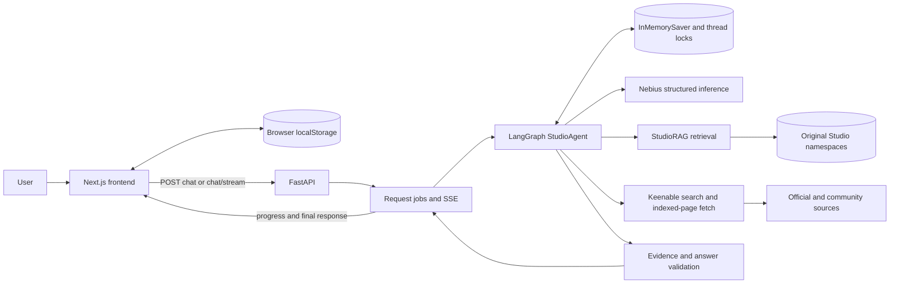

# System architecture

Creator Studio Copilot separates browser presentation and persistence, process-local orchestration, original-guide retrieval and external research.

The boxes describe components; they are not additional graph nodes. The [workflow reference](agent_workflows.md) gives the actual graph.

## Request lifecycle

1. `frontend/app/page.tsx` submits text, equipment, an optional session ID and a request UUID. Mode cards provide prompt shortcuts, not frontend intent overrides.
2. `backend/app/main.py` validates input and obtains the cached agent service. `/ask` preserves standalone grounded RAG; `/chat` runs the agent; `/chat/stream` streams actual operation events and the final structured response.
3. `ChatJobs` shares work across same-ID transports. A dropped stream can join the same job through JSON chat. Conflicting input under an existing request ID is rejected.
4. `StudioAgent` routes, retrieves/researches as needed, checks evidence and constructs an intent-specific response. Session locks serialize turns within a thread.
5. The client displays Markdown, citations, resource cards and diagnostic state. Notebook saves individual answers with their originating topic association.

## Storage boundaries

| Location | Data | Lifetime |
|---|---|---|
| Browser localStorage | Setup, recent conversations, per-answer topics, Notebook/manual titles | Current browser/origin; not account-synchronized |
| Backend memory | LangGraph checkpoints, thread locks, request jobs/events | Lost on restart; one worker required |
| Pinecone | Original-guide text, metadata and integrated embeddings | External persistent index |
| Repository | Original guides, reference manifest, golden datasets and safe evaluation evidence | Versioned source assets; generated chunks are ignored |
| External web | Official documentation and community resources | Read through Keenable; availability/freshness varies |

Browser history is bounded to 20 threads, 80 messages/thread and approximately one million serialized characters; Notebook has no equivalent history cap. Checkpoints and locks have no explicit eviction. The request cache has 64 slots, a four-thread pool and a 900-second completed-job TTL, pruned on cache access. A stored browser thread may remain readable after its backend session is gone.

## Inference, retrieval and research

`ChatSettings` defaults to Nebius `Qwen/Qwen3-30B-A3B-Instruct-2507`; environment overrides remain possible. The same model serves routing, assessment, generation and selected reviews. Agent calls use temperature 0, JSON Schema and a 2,400-token output budget; `/ask` uses JSON-object output and 900 tokens. HTTP timeout is 45 seconds with up to three transport attempts. Structured schema validation permits two attempts. Deterministic settings do not guarantee identical output or independent review.

Pinecone uses integrated `llama-text-embed-v2`, 1,024 dimensions, cosine similarity and `text → chunk_text`, with query/passage input types and truncation disabled. Runtime connects to an existing compatible index; it does not create or repopulate one. Only original Studio guides are used by active retrieval. Exact product procedures are researched through Keenable rather than inferred from generic concepts.

Keenable bounds search results and indexed-page fetches. Source content is untrusted data. Domain/product checks distinguish official documentation, community resources and unknown sources; exact procedural spans require applicable evidence. These safeguards do not prove semantic completeness or legal clearance.

## Progress, configuration and local limits

`graph/progress.py` emits `{action, label, status}` around actual operations. SSE emits `progress`, `final` or `error`; keepalive comments are transport-only. The frontend groups repeated activity and preserves failure reporting. It does not expose private reasoning or stream generated tokens.

Credentials load from `backend/.env` with process overrides. `FRONTEND_ORIGIN` is a process variable read by the API; default is `http://localhost:3000`. Provider keys remain backend-only. Optional Langfuse callbacks redact payloads and stay disabled without keys. Fireworks is an unused template placeholder, not an active inference provider.

User messages and selected evidence go to Nebius; retrieval queries go to Pinecone; research queries/URLs go to Keenable. There is no authentication or durable backend user storage. CORS is not authorization: keep the local demo single-worker and do not expose it as an unrestricted public service.
