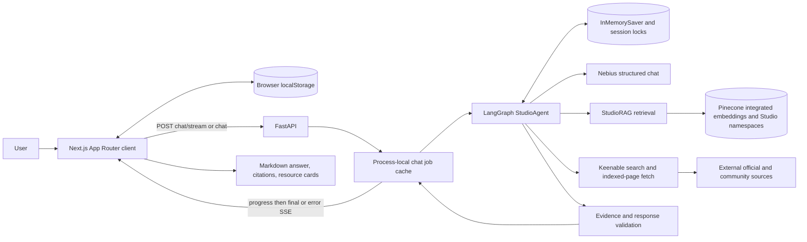

# Creator Studio Copilot: actual system architecture

Reviewed 2026-10-25 against active entry points and imports. This describes the implementation, not the original proposal. No services were queried or application code changed for this review.

## Request lifecycle

The checks box groups ordinary functions and model calls; it is not an additional LangGraph node. Web sources are read through Keenable, not copied into Pinecone. Original Studio guides are indexed separately by an explicit CLI; normal requests do not ingest anything.

1. `frontend/app/layout.tsx` installs `StudioProvider` and the shared shell. `/` renders the Assistant, `/setup` edits the selected equipment and `/notebook` displays locally saved answers.
2. `app/page.tsx` sends the user's text, optional backend session ID, equipment from `setupEquipment`, and a request UUID. Mode cards provide prompt shortcuts; they do not dictate backend intent. A selected suggestion prefills the composer. The logo shows the landing page without deleting the current thread; a mode shortcut starts a separate thread.
3. `lib/chat-stream.ts` uses **fetch with POST SSE**, not browser EventSource. The server emits operation progress and a final structured response. A transport failure falls back to `/chat` using the same UUID; application errors are displayed rather than silently retried.
4. `backend/app/main.py` validates the request and obtains the cached agent service. `ChatJobs` executes the work on a four-worker thread pool; same-ID, same-input transports join the same job. Conflicting ID reuse gets HTTP 409. The compatibility `/chat` endpoint can also run synchronously without an ID.
5. LangGraph routes the request, selects retrieval/research, evaluates applicable evidence, and assembles a validated answer. It checkpoints conversation and diagnostic state under a UUID thread ID.
6. The UI renders Markdown, citations, source provenance, resource cards and research activity. It refreshes `/sessions/{id}` for diagnostic steps. A pending action receives the “Try this next” label. Each assistant message retains its topic association for Notebook saving.

## Component responsibilities

| Component | Why it exists | Boundary |
|---|---|---|
| Next.js/React/TypeScript | Conversation UX, setup, Notebook, navigation and streaming client | Provider secrets never belong in `NEXT_PUBLIC_*` configuration |
| FastAPI | HTTP validation, health, `/ask`, `/chat`, `/chat/stream`, session inspection, local CORS | No authentication or per-user authorization implemented |
| LangGraph | Explicit bounded workflow and in-memory checkpoints across turns | Not a multi-agent system or autonomous unbounded tool loop |
| Nebius | Intent classification, evidence assessment, grounded generation and selected answer reviews | One configured model, multiple roles; no independent judge model |
| Pinecone | Managed text embeddings and semantic retrieval of original Studio material | Does not independently determine answerability |
| Keenable | Product documentation research and resource discovery | Returned content is untrusted evidence, not instructions |
| Deterministic checks | Metadata identity, source spans, product/version applicability, citations and repeated-action guards | Literal support and heuristic checks do not prove all semantic claims |

`ChatSettings` defaults to `Qwen/Qwen3-30B-A3B-Instruct-2507` at the Nebius Token Factory API. `NEBIUS_MODEL` can override it; this audit did not call the provider to reconfirm availability. The current local `.env` does not set a model override. Agent calls use temperature 0, JSON Schema output, and a 2,400-token output budget; standalone `/ask` uses JSON-object output and 900 tokens. `NebiusChat` uses a 45-second HTTP timeout and up to three transport attempts. Structured responses have at most two schema-validation attempts. Temperature 0 is not a guarantee of identical outputs.

Pinecone configuration defaults: `llama-text-embed-v2`, 1,024-dimensional dense vectors, cosine similarity, serverless AWS `us-east-1`, `text → chunk_text`, query/passage input types and `truncate=NONE`. Actual deployed configuration is checked by the client when connecting; this audit reports code configuration and saved results, not a fresh cloud inventory.

## Four distinct storage locations

| Location | Stores | Persistence and limitations |
|---|---|---|
| Browser localStorage | Setup, recent conversations, messages, per-answer topic titles, saved Notebook answers/manual titles | Origin/browser-specific, not account-synchronized; history bounded to 20 threads, 80 messages/thread and approximately 1 million serialized characters. Notebook has no equivalent history cap. Browser clearing/quota failure can lose data. |
| Backend process memory | LangGraph checkpoints, per-session locks, request jobs/progress/final responses | Lost on restart; use **one backend process/worker**. Completed jobs expire after 900 seconds on subsequent cache access; cache maximum 64 jobs. Session/checkpoint and lock collections have no explicit eviction. |
| Pinecone | Indexed original Studio text, metadata and integrated embeddings | External persistent index; original/manual namespaces are distinct. Runtime searches Studio B. |
| Files/external sources | Local original guides/manifests, ignored historical manuals/outputs; official documentation and community pages served through Keenable | Historical PDFs/outputs were archived outside the public tree in Phase 5B and are not runtime knowledge. Source availability and indexed-page freshness are external dependencies. |

Browser threads survive refresh even when backend sessions do not. Reopening a stored thread can display old messages while continuation returns session-not-found after a backend restart. This is an explicitly local MVP, not durable multi-user session storage. `backend/app/storage/notebook.py` is a placeholder: it does not persist Notebook entries.

## Evidence and progress

Original Studio Knowledge is identified as original educational material, not Apple/Focusrite documentation. `StudioRAG` verifies a retrieved guide ID, corpus marker and source hash against the local manifest. Web provenance is derived from URL/product checks. Procedures require applicable official source spans; optional unsupported material can be omitted. Documentation reference versions are not treated as installed software versions.

`graph/progress.py` emits `{action, label, status}` only around real operations. SSE event types are `progress`, `final`, `error`; comments are transport keepalives, not activity. The UI groups repeated operations and shows failures honestly. This streams activity and the final answer, **not model token deltas or hidden reasoning**.

Optional Langfuse support already exists in `services/tracing.py`; callbacks redact payloads. It is inactive when either key is absent. No Langfuse keys are populated in the inspected local environment. This review neither enabled nor changed tracing.

## Operational boundaries

All prompts, user messages and selected evidence sent for inference leave the process for Nebius. Search queries and requested URLs go to Keenable; retrieval queries go to Pinecone. No manufacturer manual upload occurs through the active Studio runtime. Phase 5B removed the legacy manual upload CLI from the public tree; the retained integration CLI accepts only its labeled synthetic smoke test. Lower-level namespace constants remain for compatibility/testing, but the public Studio builder emits originals only.

Health is credential-independent. Chat requires Nebius, Pinecone and Keenable configuration and a pre-existing compatible populated index. CORS defaults to `http://localhost:3000`; `FRONTEND_ORIGIN` is read from the process environment by `main.py`. Credentials otherwise load on demand from `backend/.env`, with environment values taking precedence. Fireworks is an unused environment placeholder, not an active provider.
